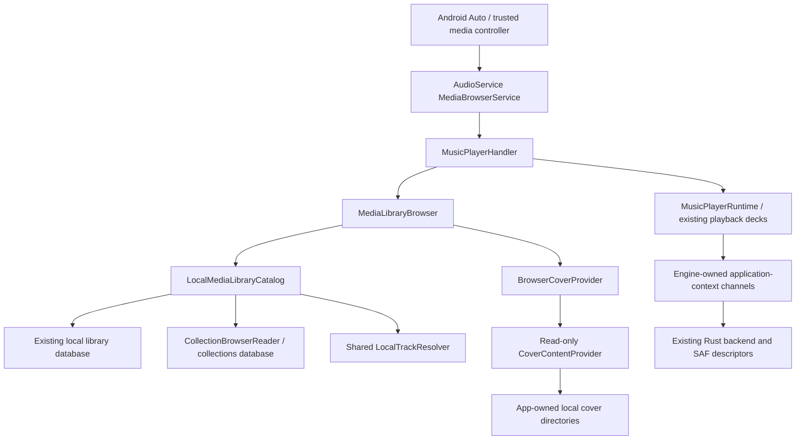

# Android Auto on the current playback engine

Implemented 2026-11-01 for the local/offline Android application. This extends the existing AudioService/MediaBrowser service and audioplayers engine; the Kotlin/Media3 migration is independent.

## User behavior

- Browse Songs, Albums, Artists and Playlists. Songs includes Shuffle library; Playlists includes Loved Songs. Empty playlists are omitted.
- Selecting a song queues its complete local context, preserving album order and repeated playlist occurrences. Artist playback is independent of the phone's Popular shelf cap.
- Search local songs, releases, artists and playlists. Structured Android voice requests support song, album, artist and playlist focus. An unnamed music request resumes an existing restored session, or shuffles the library when none exists.
- Show local covers in browse results, queue descriptions and recent/resumption items. Missing artwork retains the ordinary fallback; nothing fetches remote artwork.
- Start playback without opening the phone Activity, restore the saved session, apply saved equalizer settings and toggle Loved from the existing media controls. Background changes invalidate foreground collection state, including a change committed during Activity takeover.

Existing local queues, normalization, USB, AutoMix, gapless, lyric timing and notification controls retain their existing implementations. Folder permission grants and library scanning still originate in the phone app. This does not introduce a car-specific scanner or a second audio engine.

## Architecture

The phone and browser reuse media construction, track resolution and collection identity rules. Browser catalog dependencies are injectable for tests. Root labels resolve the saved app locale without a widget tree. Installation-state preparation is single-flight across Activity and headless startup.

Native playback channels register before Dart starts, whichever component creates the shared engine. The application-context handler resumes when an Activity detaches. Activity-only operations remain attached to the Activity. Native data jobs retain cancellation leases even when cancellation occurs before coroutine execution.

### Paging, ordering and concurrency

Browse defaults to 200 items and caps a requested page at 500. Leading Shuffle/Loved entries count toward their page. Invalid options and IDs fail closed. Library and collection reads use bounded pages; search uses the existing Unicode normalization and parameterized database queries. The existing album loader supplies phone-consistent disc/track ordering; that per-album read is not newly paginated.

Playing a complete context reads successive 500-row pages rather than truncating playback to a browse page. The resulting queue necessarily occupies memory proportional to the selected context. Repeated playlist entries retain positional identity. Virtual CUE entries are excluded from car browse results; existing phone CUE behavior is unchanged.

Request generations and queue revisions reject delayed browser results after a newer request, phone queue replacement, pause, seek, stop or disposal. Favorite reads also reject stale identity generations. Failed cover-provider discovery retries; successful discovery is cached and concurrent discovery is coalesced.

### Files and bitmap ownership

The exported cover provider permits read-only access to direct, validated image children of these app-owned directories:

| Directory | Allowed suffixes |
|---|---|
| `files/library_covers` | `.jpg`, `.jpeg`, `.png`, `.image`, `.webp` |
| `files/playlist_covers` | `.jpg`, `.jpeg`, `.png` |
| `cache/embedded_cover_previews` | `.jpg` |

The provider rejects traversal, hidden/temporary names, nested paths, writes and symlink escapes. It opens with `O_NOFOLLOW`, validates the same opened descriptor as a regular image file, and checks image signatures. It exposes no audio files, arbitrary paths, network locations or general file browser. These cover images are intentionally readable by other applications holding the published URI; the endpoint is not a private encrypted store. Existing trusted-controller browser policy remains in place.

SAF playback leases belong to an engine, survive Activity destruction and close by token or engine teardown. The table accepts at most eight descriptors and never evicts an active lease. Cleanup from a retiring engine cannot close a newer engine's descriptors. Background metadata reads use the same complete metadata reader as foreground playback.

Session and notification artwork use independent bounded bitmap copies; recycled images fall back to text metadata. Decoded notification artwork retains at most three recent images, each bounded to 512 pixels per dimension. Memory trim keeps only the current entry. Cached/session-owned bitmaps are not manually recycled by consumers. Queue artwork URI conversion changes queue descriptions without replacing the phone's original metadata artwork URI.

## Verification

Final host verification (2026-11-01): `flutter analyze` reports **No issues found**; full `flutter test --reporter expanded` reports **2,349 passed, 3 skipped, 0 failures** (5m25s). `bash scripts/check_android.sh -Ptarget-platform=android-arm64 :audio_service:testDebugUnitTest` succeeds: app **93 passed, 1 skipped**, vendored audio_service **11 passed**. Android instrumentation Kotlin and Java compilation succeeds via `:app:compileDebugAndroidTestKotlin :app:compileDebugAndroidTestJavaWithJavac`; no packaging/install task was requested.

Host tests cover browser roots, pagination beyond 500 rows, complete context queues, repeated playlist positions, structured/unnamed voice queries, local artwork URI rules, discovery retries, database ordering/search, late request cancellation, background favorites and UI takeover, runtime disposal and saved equalizer settings.

Native JVM tests cover cover directory rules, traversal, links, signatures and recent-art cache behavior. Instrumentation sources cover provider read/write restrictions, per-engine descriptor ownership and bitmap ownership. Compiling instrumentation is not device execution.

After preserving remote player-animation updates through `6d635e09` in merge `94a2b974`, analysis and the complete Flutter suite were run again: **2,349 passed, 3 skipped, 0 failures** (5m28s). Refreshed graph `aee55d59` validates 27,705 unique nodes and 53,103 links with no dangling endpoints.

Android Auto Desktop Head Unit, physical cars/phones, OEM lifecycle/background restrictions, audible playback transitions, SAF provider behavior on devices and measured device memory/battery performance remain **unverified**. No APK was built or installed for this work.

## Device acceptance checklist (pending)

Use an equivalent installed build and a seeded offline library; this work does
not package that build. Record device/Android version, Android Auto version,
output route and whether the Activity was alive for each case.

1. With the phone app closed, connect DHU/car, open all four roots, and start a
   song. Confirm saved session/EQ and original file permissions are honored.
2. Browse a library/playlist larger than 500 songs. Select near a page boundary,
   then Next/Previous across it; verify the full context and duplicate playlist
   occurrences. Compare album order with the phone.
3. Search by title/artist and issue focused album/artist/playlist voice requests.
   Issue an unnamed music request with and without a restored queue.
4. Verify local covers in browse, queue and recent items, then remove a cached
   cover and retry. Confirm a missing/recycled cover preserves text and controls.
5. Love/unlove while headless; open the phone during the operation and verify
   both views agree. Repeat after changing tracks rapidly.
6. During a slow browse/play request, replace the queue on the phone, pause,
   seek and stop. Confirm delayed work never starts an obsolete selection.
7. Detach/recreate the Activity while playing a SAF file, disconnect/reconnect
   the car, and exercise service/engine teardown. Verify no stale callbacks,
   lost active descriptors or steadily growing descriptor/bitmap counts.
8. Exercise low-memory trim, revoked folder access and unavailable SAF documents.
   Confirm readable errors/fallbacks and retry without a crash or network access.

These checks are a release gate for device claims, not completed host results.

## Upstream provenance

Reference: upstream Mornye v5.3.0, `afee4332a257f1b6aeb288229eddf04ac0777b3c`.

Adapted concepts and selected code from `4682990e` (library/headless browsing), `8b36e856`, `7d5bbd30`, `e913f09d`, `40e55df0`, `9019e853` (local cover transport and validation), `a7f84b6d` (queue artwork), `22e3536d` (bitmap safety) and `f2cf97a3` (bounded recent artwork cache). Adapted LGPL code retains attribution; complete terms are in `assets/licenses/android_auto.txt`, registered with the in-app license page. Existing audio_service licensing remains intact.

The upstream 512 KB preference-session fix is not transplanted: this target already stores full session media JSON in SQLite. Network cover-store and downloaded-library paths are excluded. No new package dependency, Media3 migration, FFmpeg removal or Rust/C++ replacement is included.
