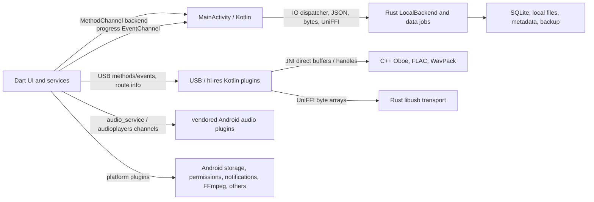

# Native bridge audit

Reviewed revision: `f4fd072` (`desloppify/code-health`). The local branch was 49 commits behind the fetched remote at the start; this report does not cover those newer commits. The branch was subsequently fast-forwarded to `9d2e7d0` for publication; intervening changes were not reviewed here. Audit date: 2026-10-30. Production code was not modified. This is a static review plus host tests; no Android device was attached (`adb devices -l` was empty). Conclusions about device behavior, safety under adversarial scheduling, memory use, and performance require device verification. External plugin internals were inventoried by registered package and vendored audio channels, not exhaustively audited; this report is not a complete security certification.

## 1. Inventory and dependency diagram

### App-owned channel routes

| Channel | Dart caller | Native handler and role |
|---|---|---|
| `com.amwolfstein.sistrum/backend` | `lib/services/native/*`, `lib/services/native_log_source.dart` | `MainActivity.kt:58,673`; Android SAF, file leases, metadata, scan, storage, jobs and native logs. Unknown application calls dispatch through `SelectedCoreBackend.kt:17-41,337-358` to UniFFI/Rust. Native sends `libraryScanError` and `libraryStorageChanged` back to `NativeBackendEvents`. |
| `com.amwolfstein.sistrum/library_scan_progress_stream` | `library_scan_bridge.dart` | `MainActivity.kt:60-61,654-668`, `SafScanProgressStream.kt`; EventChannel emits native progress; sink stops on cancel. |
| `com.amwolfstein.sistrum/audio_output` | `lib/widgets/status/audio_output_button.dart` | `MainActivity.kt:633`; Android output switcher. |
| `com.amwolfstein.sistrum/audio_route` | `lib/services/playback/audio_route_info.dart:181` | `UsbBitPerfectPlugin.kt:43-55`; background extractor, main-thread reply. |
| `com.amwolfstein.sistrum/usb_pcm` and `/usb_pcm/events` | `usb_pcm_bridge.dart`, playback decks | `UsbBitPerfectPlugin.kt:38-115`; PCM/USB/hi-res preparation, commands and event stream; engine-owned. |
| `com.amwolfstein.sistrum/haptics` | `music_haptics.dart:359` | `MusicHapticsPlugin.kt:26`; haptic operations. |
| `com.amwolfstein.sistrum/player_widget` | `player_widget_service.dart` | `PlayerWidgetProvider.kt:206-292`; widget commands/updates. |

The backend channel dispatches: `setScreenAwake`, `getAppLogcat`, `ensureInstallMarker`, `exitApp`, `getBackendImplementations`, `pickSafTree`, `safExists`, `safReleaseTree`, `safExistsBatch`, `probeSafTreeReadAccess`, `safDelete`, `safStat`, `safCopyToTemp`, `safOpenPlaybackLease`, `safClosePlaybackLease`, `safCreateFromPath`, `shareContentUri`, `readFileMetadata`, `editFileMetadata`, `writeTempToSaf`, `extractCoverToFile`, `startBackgroundWork`, `updateBackgroundWork`, `stopBackgroundWork`, `releaseMemory`, `releaseMemoryUnderPressure`, `setLibraryCoverCacheDir`, `scanLibraryFolderToNDJSONFile`, `scanSafTreeToNDJSONFile`, `getSafFileModTimes`, `getLibraryScanProgress`, `getLibraryScanExitInfo`, `cancelLibraryScan`, `pauseLibraryScan`, `resumeLibraryScan`, and `parseCueSheet`. Application dispatch additionally handles `runNativeDataJob`, `cancelNativeDataJob`, `acquireMediaDirectory`, `releaseMediaDirectory`, `getLogsSince`, `clearLogs`, and `setLoggingEnabled`. See `MainActivity.kt:677-1151` and `SelectedCoreBackend.kt:17-41,337-358` for exact contracts and errors.

### UniFFI, FFI, JNI and plugins

- `NativeDataJobs.run` (`lib/services/native/native_data_jobs.dart:29-80`) JSON-encodes in an isolate, sends JSON and optional bytes on the backend channel, Kotlin parses JSON and acquires `RequestLease`, then `com.sistrum.backend` generated UniFFI bindings call Rust (`SelectedCoreBackend.kt:17-104`, `NativeDataJobs.kt`, `rust_backend/crates/mobile/src/data_jobs.rs`). Operations cover M3U, ID3, lyrics, palette, automix, spectral analysis, scanning, library snapshots, collections, playlist writes, backup, and cache. Kotlin can spill large JSON responses to a temporary file, which Dart decodes off-isolate and deletes (`MainActivity.kt:356-379`, `native_channel.dart:39-55`). Cancellation leases are acquired before dispatch and released in `finally`; Rust deliberately respects committed results.
- Other exported UniFFI boundaries are `CancellationRegistry`/`RequestLease` (`cancellation.rs`), `LocalBackend`/directory leases (`local.rs`), scan, metadata, tags, CUE and cover operations (`tags.rs`, `library_metadata.rs`), `LogBuffer` (`logging.rs`), and `UsbDirectOutput` (`usb_audio/mod.rs`). Bindings are generated by `scripts/build_rust_backend.sh` and compiled from `rust_backend/target/bindings/kotlin`; shared libraries are staged to `jniLibs`. The generated binding layer uses FFI/JNA; app Dart contains no direct `dart:ffi` or Pigeon definitions in the inspected source. Transitive packages include `jni`, `jni_flutter`, `jni_util`, and `sqlite3`; lack of an app-owned Dart FFI declaration does not mean dependencies have no FFI/JNI.
- `NativeAudio.kt` exposes 18 JNI entry points to `android/app/src/main/cpp/native_audio.cpp`: Oboe open/write/bits/device/start/flush/frames/close; WavPack open/info/read/seek/close; FLAC open/info/read/seek/close. `native_audio.map` lists exported JNI symbols. Kotlin workers and handle tables manage lifetime; FLAC/Oboe use direct buffers, WavPack DSD returns byte arrays. Direct USB uses Kotlin `UsbDirectPlayback` → UniFFI `UsbDirectOutput` → Rust `usb_audio/transport.rs` → libusb.
- Vendored `audioplayers_android` registers `xyz.luan/audioplayers`, `xyz.luan/audioplayers.global`, `xyz.luan/audioplayers.global/events`, and `xyz.luan/audioplayers/events/$playerId`; the app calls `setEqualizer` directly (`music_playback_deck.dart:115,139`). Vendored `audio_service` registers `com.ryanheise.audio_service.client.methods` and `.handler.methods` (`AudioServicePlugin.java:143-144`). Android uses MediaPlayer/AudioTrack, Oboe, USB/libusb, FLAC, WavPack and FFmpeg for retained editing/analysis; these are distinct paths, not evidence of needless duplication.
- Generated Android plugin registration additionally lists `android_file_picker`, `audio_session`, `device_info_plus`, `ffmpeg_kit_flutter_new_audio`, `flutter_local_notifications`, `jni`, `jni_flutter`, `open_filex`, `path_provider_android`, `permission_handler_android`, `share_plus`, `shared_preferences_android`, `sqflite_android`, `url_launcher_android`, and `volume_controller`; `integration_test` is test-only. Their private channel/Pigeon/FFI APIs and transitive native libraries require a separate per-plugin audit. Names and internals can change with the lockfile; do not treat this list as a complete enumeration of third-party methods.
- Pigeon/JNI is present in dependencies: the installed `shared_preferences_android` contains generated `messages_async.g.jni.dart` using `package:jni` and Pigeon options; `url_launcher_android` contains Pigeon-generated Android interfaces. `jni` loads its own Dart FFI library. Those are plugin-owned boundaries; their full generated method and lifetime audit is outstanding. This qualifies the app-owned source search above.
- Supported app targets: Android API 24+ (`flutter.minSdkVersion`), target SDK 37; shipped Rust ABIs `arm64-v8a` and `armeabi-v7a`, with API-24 cross linkers (`android/app/build.gradle.kts:32-40,98-115`, `scripts/build_rust_backend.sh`). USB PCM mixer path is API 34 gated; other USB paths have separate capability gates. This is static compatibility evidence, not a device pass.

### Unused/duplicated candidates

`cancelNativeDataJob` is handled before `invokeApplication` (`SelectedCoreBackend.kt:18-23`), so its second case at `:351` is unreachable from the one repository caller at `:35`. This is low-impact redundant dispatch; check generated/external callers before removing. The current build workspace contains stale generated old-package UniFFI Kotlin alongside current bindings; generation writes to a shared output directory. It is not known whether stale bindings are packaged or callable. A clean-build check is needed; do not delete user outputs during audit.

## 2. Correctness and safety findings

Severity reflects potential impact, not measured frequency. Reproduction status is explicit.

1. **P2 — JNI modified UTF-8 used as filesystem UTF-8.** `native_audio.cpp:246-250,297-301` passes `GetStringUTFChars` to WavPack/FLAC open functions. JNI produces modified UTF-8, whereas Linux paths use ordinary UTF-8; supplementary characters are encoded as surrogate sequences. `UsbPcmSource.kt:30-43` can open the real path with Java before `NativeAudio.openFlac` receives it. Code-level mismatch confirmed; device behavior, fallback, and extent not reproduced. Affects non-BMP local filenames on exact FLAC/DSD paths; SAF `/proc/self/fd` paths can avoid it. Add device fixtures with emoji filenames; review fd ownership or explicit normal UTF-8 bytes and NUL rejection.
2. **P2 — SAF failure cause lost.** `MainActivitySafIo.kt:131-177` maps denied and other copy failures to `null`; `MainActivity.kt:856-862` replies successfully with that value. Consumers such as audio analysis and ReplayGain cannot distinguish permission loss from I/O failure. The code path is confirmed; incidence not measured. Design a typed error while preserving user-facing fallback and permissions handling.
3. **P2 — logcat deadline does not bound read.** `MainActivity.kt:116-126` reads process stdout to EOF before invoking `waitFor` with a timeout. If `logcat` leaves the pipe open, the wait and forced destruction are never reached; the IO worker/caller can remain blocked. Conditional trigger is a stuck subprocess, not a reported production incident. Test a subprocess that keeps stdout open; apply a deadline while draining bounded output.
4. **P2 — cancellation checkpoint gap.** `NativeDataJobs.kt:54-75` checks cancellation before each page but processes up to 500 SAF entries via `getSafFileModTimes` (`MainActivitySafScan.kt:1648+`) without per-provider cancellation checks. `SelectedCoreBackend.kt:97-104` copies snapshots without chunk cancellation. The missing checks are confirmed; latency/impact are unmeasured. Test a slow provider and cancellation during paging/copy; preserve commit semantics and cleanup.
5. **Needs reproduction — SAF lease invalidation.** `MainActivity.kt:536-544,563-603` evicts an oldest descriptor at four and closes all leases on Activity destruction, including recreation. Dart retains a `/proc/self/fd` lease through asynchronous source preparation (`music_player_playback.dart:129-169`) until the player duplicates it. Rotate during that window and overlap five leases; assert source identity, not merely no crash. An actual failure or wrong-file playback has not been observed. Do not extend descriptor lifetime without preserving ownership, shutdown, and fallback guarantees.
6. **Needs fault injection — USB shutdown can wait indefinitely.** `usb_audio/transport.rs:526-550` cancels asynchronous transfers and drains until callbacks clear pending slots, discarding event-pump errors; `:179-187` joins the worker. A persistent event-pump failure while a transfer stays pending can prevent completion. This is a conditional code-path risk, not a measured hang. Inject failures and detach; never free a pending libusb transfer/buffer merely to impose a timeout.

## 3. Coverage and gaps

Existing Dart tests include `usb_pcm_bridge_test.dart`, `native_data_job_bridge_test.dart`, `platform_bridge_metadata_test.dart`, `native_log_source_test.dart`, `native_log_polling_test.dart`, and library/backup native adapter tests. Those five selected files ran here: **16 passed**. The new host mock transport benchmark also exercises 3,000 ordered request/reply payloads and error/handler removal: **2 passed**. These mocks do not exercise Kotlin or native teardown.

Android instrumentation exists for `RemoteSafPlaybackTest`, `UsbBitPerfectPluginTest`, `SafScanChildrenTest`, `SafDocumentLookupTest`, `LibraryScanStressTest`, `HiResPlaybackTest`, and native jobs/backup integration tests. C++ FLAC and Rust USB/cancellation tests exist; `NativeDataJobsTest.kt` uses a host library when configured and may skip without it. None of these Android/device tests was executed in this audit. Missing: JNI Unicode-path cases, five overlapping SAF leases plus rotation, late channel replies after engine detachment, slow-provider and large-copy cancellation, libusb failure/detach callbacks, and repeated open/close/late-handle race stress on actual ABIs. No production changes were made.

## 4. Benchmark methodology and results

`test/bridge_transport_benchmark_test.dart` uses Flutter's **host mock** binary messenger, StandardMethodCodec, a mock echo handler, 50 warmups and 1,000 sequential measured calls per payload. It reports nearest-rank p50/p95/p99 (microseconds), whole-loop operations/s, and process RSS before/after. Stopwatch timing includes test/messenger/codec scheduling, and throughput includes assertions. This is a single diagnostic run, not Android, JNI, UniFFI, true platform dispatch, or a native operation; no bridge-only or before/after claim follows from it. RSS is a noisy process snapshot, can decrease due to GC, and is not allocation count or peak memory.

| Payload bytes | p50 µs | p95 µs | p99 µs | calls/s | RSS delta bytes |
|---:|---:|---:|---:|---:|---:|
| 0 | 43 | 99 | 185 | 17,736.5 | +9,388,032 |
| 1,024 | 26 | 67 | 151 | 24,358.2 | -1,421,312 |
| 65,536 | 31 | 134 | 336 | 17,300.7 | -1,552,384 |

Reproduce: `source /workspace/toolchains/activate.sh && flutter test --no-pub --reporter expanded test/bridge_transport_benchmark_test.dart`. Host: Linux x86_64, Flutter 3.47.7/Dart 3.13.5, debug test runtime; concurrent load, clock resolution, and GC are uncontrolled. These values are not a baseline for a release Android device.

`integration_test/bridge_latency_benchmark_test.dart` is an unrun on-device harness: 30 warmups and 500 small `getBackendImplementations` calls, percentiles, throughput and process RSS delta. Run on an attached device with `flutter test --profile integration_test/bridge_latency_benchmark_test.dart -d <device-id> --reporter expanded` after the project's SDK preparation. This executes a production query and includes Kotlin method execution; it does not isolate native work or measure allocation bytes. No device results are available here.

For actual optimization evaluation, use equivalent profile/release builds, same commit/config, device, OS, ABI, temperature and thermal state; record warmup, sample count, clock, median and p95/p99 across repeated runs. Add test-only instrumentation (no production echo endpoint without review) for no-op channel/UniFFI/JNI controls, matched payload sizes, codec-only and native-only controls, allocations via Android Studio/Perfetto, peak/steady RSS, frame/UI heartbeat, USB underruns and bit-exact output. Compute operation overhead only from paired measurements with uncertainty; never subtract host mocks from device results. Exercise small and large JSON/bytes, 128/256 KiB spill boundaries, cold/warm paths, failure/cancel, 60-second PCM sessions, both ABIs and representative API levels. Report device/model and sample distributions. No before/after performance comparison or improvement claim is possible before an approved implementation and identical-device runs.

## 5. Prioritized proposals

| Priority | Item | Evidence/impact | Risk and prerequisite |
|---|---|---|---|
| 1 | Unicode JNI path correctness | Code-level encoding mismatch; user impact unmeasured | Medium: device fixture, Unicode bytes/fd ownership, compatibility tests. |
| 2 | SAF lease lifecycle and USB drain | Potential wrong-source/incomplete teardown under specific races | High: reproduce first; preserve buffer/fd ownership and callbacks. |
| 3 | Error propagation, log timeout, cancellable scans | Code-confirmed lost reason and unbounded/blocking paths; timings unmeasured | Medium: typed errors, provider-failure and cleanup tests. |
| 4 | Direct USB copy/poll profiling | `UsbDirectPlayback.kt:219-251` checks available bytes, duplicates buffer, copies into reusable byte array, then UniFFI serializes; polls every 5 ms | Medium/high: measure allocations, p95/p99 and underruns before proposing batching/direct buffers. No measured win yet. |
| 5 | Remove duplicated cancellation dispatch / clean generated binding outputs | Static redundant case and possible stale generated source | Low but check callers and clean-build/packaging first. |

## 6. Safe implementation phases

1. Review this report and confirm intended behavior; reproduce the encoding, lease, timeout, and cancellation cases with tests before changing implementation.
2. Land isolated fixes with focused unit, Kotlin, Rust, JNI, integration, lifecycle, and stress coverage, preserving error and data contracts. Keep Android 24+, both ABIs, offline behavior, FFmpeg, existing audio engine and Rust/C++ implementations.
3. Run project analysis and relevant full suites, host native checks and instrumented device tests; compare Android 24/legacy ARM32 and modern ARM64. Verify device playback, seek, metadata, SAF, USB detach and background/resume. Report skipped tests distinctly.
4. Only after reproducible equivalent-device baselines identify a bottleneck, propose measured batching/caching/buffer changes and compare before/after percentiles, allocations, RSS, UI heartbeat and audio integrity. Do not replace MethodChannels with FFI/JNI by default.

No APK was built during this audit. Results are a partial audit of app-owned routes, with plugin internals, actual-device race reproduction, allocation profiling, and comparative measurements outstanding.
